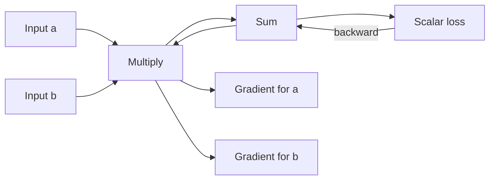

# Gradix

Gradix is a small, educational deep-learning engine built around a `Tensor` class and automatic differentiation. It lets you compose tensor operations, build neural-network layers, calculate gradients with `backward()`, and update parameters with SGD.

The project is intentionally compact and is useful for learning how computation graphs and training loops fit together. It is not a drop-in replacement for PyTorch or another production deep-learning framework.

## What You Can Do

- Create tensors and combine them with arithmetic, matrix multiplication, reductions, and activations.
- Track operations in a computation graph and calculate gradients with backpropagation.
- Build models with `Linear` and `Conv2D` modules.
- Calculate classification loss with `cross_entropy` and update parameters with `SGD`.
- Visualize a tensor's computation graph with Graphviz.

## Install

Gradix requires Python 3.10 or newer. Install the published package and its required Python dependencies with:

```bash
pip install gradix
```

The base installation includes NumPy, the Python Graphviz binding, and Matplotlib. Graph rendering also requires the Graphviz system executable (`dot`), which must be installed separately through your operating system's package manager.

For example, on Ubuntu or Debian:

```bash
sudo apt install graphviz
```

CuPy is optional. The `gpu` extra currently requests the CUDA 12.x CuPy build:

```bash
pip install "gradix[gpu]"
```

You also need a compatible NVIDIA driver and CUDA setup. CPU usage is the recommended path for the current version; CUDA support is experimental, and some operations, particularly Conv2D's patch-index creation, still use NumPy internally.

### Install From a Local Checkout

When working in a clone of this repository, install the current source in editable mode:

```bash
python -m pip install -e .
```

This makes `import gradix` work from that Python environment without adding `src` to `sys.path` manually. In Jupyter, choose the same environment as the notebook kernel.

## Your First Tensor

```python
from gradix import Tensor

left = Tensor([1.0, 2.0, 3.0], requires_grad=True, name="left input")
right = Tensor([4.0, 5.0, 6.0], requires_grad=True, name="right input")

result = (left * right).sum()
result.backward()

print(result.data)  # 32.0
print(left.grad)    # [4. 5. 6.]
print(right.grad)   # [1. 2. 3.]
```

`requires_grad=True` asks Gradix to track operations that contribute to that tensor. Calling `backward()` on a result propagates its gradient backward through those operations. Gradients are stored in each participating tensor's `.grad` attribute.

Tensor names can be assigned at construction or afterward. Any non-`None` value is converted to a string:

```python
image = Tensor([0.0, 1.0], name=1)
image.name = 2.5
assert image.name == "2.5"
```

## Public Imports

Gradix re-exports common classes at convenient package levels:

```python
from gradix import Tensor
from gradix.nn import Linear, Conv2D, cross_entropy, SGD
from gradix.nn.modules import Module, Linear, Conv2D, Upsample
from gradix.nn.loss import cross_entropy
from gradix.nn.optim import SGD
```

## How Backpropagation Flows

Each operation creates a result tensor that remembers its input tensors and a local backward function. For example, matrix multiplication records its operands. When `backward()` is called, Gradix traverses the graph and applies those local derivatives from the output toward the inputs.



The core idea in code is:

```python
prediction = model(batch)
loss = cross_entropy(prediction, targets)
optimizer.zero_grad()
loss.backward()
optimizer.step()
```

`zero_grad()` clears gradients from the previous batch. `backward()` calculates gradients for this batch. `step()` uses those gradients to update parameters.

## Visualize a Computation Graph

The graph examples in `demos/digraph_test.ipynb` build longer expressions and ask Graphviz to display their operation dependencies. Here is a smaller version:

```python
from gradix import Tensor
from gradix.utils import visualize_computation_graph

a = Tensor(1.0, requires_grad=True, name="a")
b = Tensor(2.0, requires_grad=True, name="b")
c = Tensor(3.0, requires_grad=True, name="c")

result = (a + b) * c
result.backward()

graph = visualize_computation_graph(
	result,
	filename="example_graph",
	c_view_options=["data", "grad"],
)
graph
```

Each box represents a tensor and each ellipse represents an operation. Edges connect an operation to its result and its inputs. Tensor names, shapes, scalar data, and scalar gradients can help identify nodes. Graphviz's `dot` executable must be installed for rendering.

The attention-style example in `demos/digraph_test.ipynb` follows this flow:

1. Create input and weight tensors for query, key, value, and projection operations.
2. Compute query-key scores with matrix multiplication and a transpose.
3. Apply a numerically stabilized softmax using max, exponentiation, and sum.
4. Multiply attention weights by values, then apply a projection.
5. Add a residual connection and normalize using mean and variance operations.
6. Pass through a small MLP, combine the residual output, reduce to a scalar loss, and visualize the full graph.

The notebook also builds a recurrent, gated sequence example. Each time-step appends more operations to the same graph through the hidden state; reducing the final hidden state to a scalar and visualizing it shows how dependencies span time steps.

`demos/demo.ipynb` contains a smaller arithmetic graph. The corresponding examples are notebooks, so run cells from top to bottom after installing Gradix and Graphviz.

## Define a Model

Models subclass `Module`, implement `forward`, and return all trainable tensors from `parameters`. The `Linear` layer accepts a batch whose last dimension matches `in_features`.

```python
from gradix.nn.modules import Linear, Module


class SmallClassifier(Module):
	def __init__(self):
		self.hidden = Linear(784, 128, bias=True)
		self.output = Linear(128, 10, bias=True)

	def parameters(self):
		return self.hidden.parameters() + self.output.parameters()

	def forward(self, x):
		x = x.reshape(x.shape[0], 784)
		x = self.hidden(x).relu()
		return self.output(x)
```

The MNIST examples in `demos/MnistModel.py` show two model shapes:

- `MNISTModel`: flatten each 28-by-28 image, apply a 784-to-128 linear layer with ReLU, then produce 10 class scores.
- `MNISTConvModel`: reshape to `(batch, 1, 28, 28)`, apply three Conv2D layers with ReLU, flatten the result, and produce 10 class scores.

The convolutional model's `parameters()` method combines the parameters from each child layer. Gradix modules do not currently automatically register nested modules, so a custom model should explicitly return its parameters as above.

## Train a Model

Gradix's `cross_entropy` expects logits shaped `(batch, classes)` and integer class labels in a target tensor. The targets do not need gradients. This self-contained example demonstrates the same batch flow used in `demos/train.ipynb` without downloading a dataset:

```python
import numpy as np

from gradix import Tensor
from gradix.nn.loss import cross_entropy
from gradix.nn.modules import Linear, Module
from gradix.nn.optim import SGD


class TinyClassifier(Module):
	def __init__(self):
		self.layer = Linear(2, 2, bias=True)

	def parameters(self):
		return self.layer.parameters()

	def forward(self, x):
		return self.layer(x)


x = Tensor(np.array([[1, 0], [0, 1], [1, 1], [0, 0]], dtype=np.float32))
targets = Tensor(np.array([0, 1, 0, 1]))

model = TinyClassifier()
optimizer = SGD(model.parameters(), lr=0.1)

for step in range(20):
	logits = model(x)
	loss = cross_entropy(logits, targets)

	optimizer.zero_grad()
	loss.backward()
	optimizer.step()

	print(f"step {step + 1}: loss={float(loss.data):.4f}")
```

In each step, the model produces one score per class, cross-entropy compares those scores with the labels, and backpropagation computes parameter gradients. SGD then updates the parameters. This is a minimal educational loop; it does not include features such as batching helpers, schedulers, regularization, checkpointing, or automatic device placement.

## MNIST Notebook Workflow

`demos/train.ipynb` demonstrates the larger workflow:

1. Load MNIST with scikit-learn's `fetch_openml` and split pixels and labels into training, validation, and test sets.
2. Convert pixel arrays to `float32`, scale pixels into the 0-to-1 range, and convert labels to integers.
3. Create `MNISTModel` or `MNISTConvModel`, then pass `model.parameters()` to `SGD`.
4. Iterate over mini-batches. For each batch, create input and target tensors, run the model, calculate cross-entropy, clear gradients, call `backward()`, and update parameters.
5. Calculate validation loss without calling `backward()`, then evaluate on the test data after training.
6. Plot training and validation loss with Matplotlib and optionally visualize the model's graph.

The notebook uses additional packages for the example workflow. Install them in the notebook's Python environment if they are not already present:

```bash
python -m pip install scikit-learn tqdm
```

Matplotlib is already a required Gradix dependency. Fetching MNIST requires an internet connection the first time. Training the full dataset, particularly with the pure-Python Conv2D implementation, may take a while.

## API at a Glance

| API | Purpose |
| --- | --- |
| `Tensor(data, requires_grad=False, name=None)` | Store array data and optionally track gradients. |
| `tensor.backward()` | Compute gradients from a scalar result back through its graph. |
| `tensor.zero_grad()` | Clear gradients in the tensor's graph. |
| `Module` | Base class for models with `forward()` and `parameters()`. |
| `Linear(in_features, out_features, bias=False)` | Fully connected transformation. |
| `Conv2D(in_channels, out_channels, kernel, stride=1, padding=0, use_bias=False)` | Two-dimensional convolution. |
| `cross_entropy(logits, targets)` | Mean multiclass cross-entropy for integer class labels. |
| `SGD(parameters, lr=0.001)` | Basic stochastic gradient descent optimizer. |
| `visualize_computation_graph(tensor, ...)` | Return or render the tensor's operation graph. |

## Project Layout

```text
src/gradix/             Library implementation
  tensor.py             Tensor and automatic differentiation
  nn/                   Functions, modules, losses, and optimizer
demos/MnistModel.py     Example fully connected and convolutional models
demos/demo.ipynb        Small tensor and graph examples
demos/digraph_test.ipynb Attention-style and recurrent graph examples
demos/train.ipynb       MNIST data preparation, training, and evaluation
tests/test_conv2d.py    Conv2D comparison against PyTorch
```

## Development Checks

Install the project and run the Conv2D comparison from the repository root:

```bash
python -m pip install -e .
python -m pip install torch
PYTHONPATH=src python tests/test_conv2d.py
```

The test uses PyTorch only as a reference implementation. The library itself does not depend on PyTorch.

## Current Limitations

- Gradix is educational software and implements a small subset of tensor and neural-network functionality.
- CPU execution is the most suitable current path. CUDA support is experimental; Conv2D currently constructs some intermediate indices with NumPy and has not been validated on a real CUDA device.
- Models explicitly implement `parameters()`; nested layers are not automatically discovered.
- Dataset loading and notebook conveniences such as scikit-learn and tqdm are separate from the core package dependencies.
- The Graphviz Python package does not include the Graphviz system executable.

## License

See [LICENSE](LICENSE).
